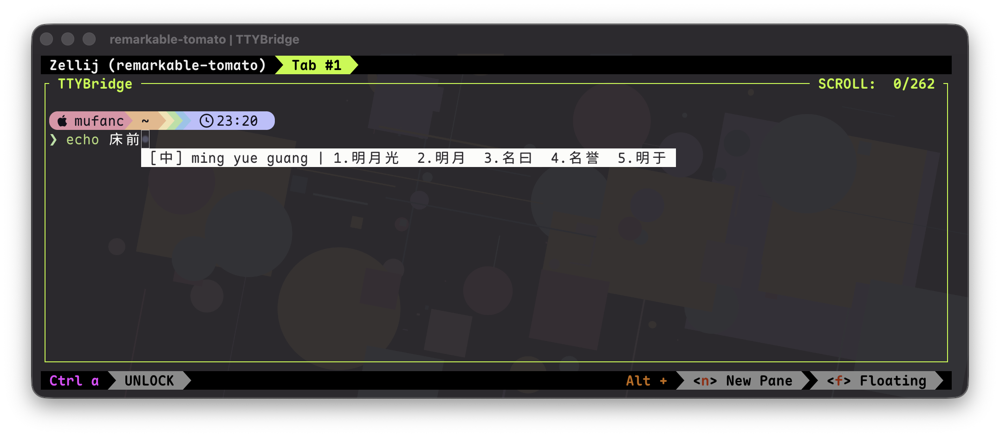

# rime-fep

基于 Rime 的终端中文输入法前端。`rime-fep` 在 PTY 中运行 shell 或其他命令，并在光标附近显示输入状态和候选词，适用于本地终端和 SSH。



## 构建

### 本机构建

需要 Rust、C 编译器，以及 librime 和 OpenCC。macOS 可通过 Homebrew 安装运行库：

```sh
brew install librime
git submodule update --init --recursive
cargo build --release
```

librime 位于非标准路径时，可设置 `RIME_INCLUDE_DIR` 和 `RIME_LIB_DIR`。

### Linux x86_64 全静态构建

需要 `cross` 和可运行 `linux/amd64` 容器的 Docker 引擎。在项目根目录执行：

```sh
# macOS 上先准备 Linux Rust 工具链
rustup toolchain install stable-x86_64-unknown-linux-gnu \
  --profile minimal --force-non-host --target x86_64-unknown-linux-musl

git submodule update --init --recursive
cross build --release --target x86_64-unknown-linux-musl
```

产物为 `target/x86_64-unknown-linux-musl/release/rime-fep`，可直接复制到 x86_64 Linux 运行。

## 使用

```sh
# 启动 $SHELL
target/release/rime-fep

# 启动指定命令
target/release/rime-fep -- zellij
target/release/rime-fep -- /bin/zsh -l
```

| 按键 | 功能 |
| --- | --- |
| `Ctrl+\` | 开启或关闭输入法 |
| `` Ctrl+` `` | 打开 Rime 方案选单 |
| 数字键 | 选择候选词或选单项 |
| `Esc` | 取消当前输入 |

## 配置

默认使用 Rime 官方的朙月拼音配置。也可以指定一份未编译的 Rime 配置目录：

```sh
target/release/rime-fep --config-dir ~/.config/rime
```

指定目录只读；配置会与内置文件合并后编译到系统缓存目录，原目录不会被修改。编译缓存和用户数据按配置指纹隔离；首个终端会自动启动对应的后台进程，最后一个终端退出后进程随即结束，输入学习记录会保留。

## 限制

- 在传统终端协议下，`Ctrl+Space`、`Ctrl+@` 和 `` Ctrl+` `` 无法区分。
- 全静态 Linux 版本不支持外部动态插件。
